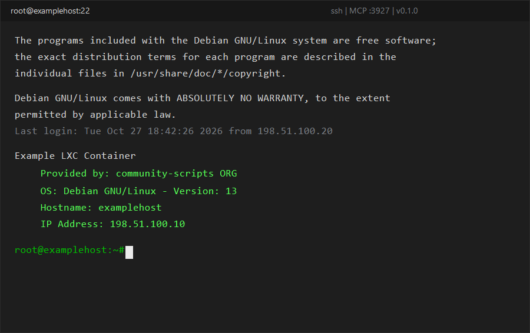

# putty-rs

**PuTTY, re-forged in Rust — same terminal, sharper edges.**

A clean-room PuTTY 0.83-inspired SSH/Telnet/Raw terminal emulator for Windows,
written in **100 % safe Rust** (pure-Rust stack: `eframe`/`egui` GUI, `vt100`
terminal engine, `russh` SSH, `winreg` persistence) — **no C, no OpenSSL**.

Unlike a straight port, `putty-rs` was driven by **reverse-engineering evidence**
gathered from the shipped `putty.exe` 0.83 x64 binary (Ghidra via the REA
toolkit): window class, dialog captions, CLI flags, registry value names,
auth prompts, proxy templates and even the negotiated KEX on a live server
were all *observed* first — see `docs/REA_EVIDENCE.md` (French, internal lab
notes).



## Why

PuTTY is legendary; its codebase is not. This project keeps the parts people
rely on (registry sessions compatible with real PuTTY, `SSH-2.0` behaviour,
xterm emulation, mouse/clipboard semantics) and rewrites everything else in a
memory-safe language with modern niceties:

| Feature | putty-rs 0.1 | PuTTY 0.83 |
|---|---|---|
| GUI | `egui` immediate-mode, **dark "professional" theme by default** | Win32 GDI, classic light |
| Session registry | reads/writes `HKCU\Software\SimonTatham\PuTTY\Sessions` (same keys: `HostName`, `PortNumber`, `Colour0..21`…) | ✔ same |
| Backends | SSH-2 (`russh`), Raw TCP, Telnet (IAC negotiation), rlogin-as-raw | + serial, SSH-1, proxies, X11/agent forwarding |
| OpenSSH private keys | **loads `id_ed25519` & co. directly** (native PuTTY 0.83 refuses them!) | PPK only |
| PPK v2/v3 | explicit, clear error (roadmap: v0.2) | ✔ |
| Multi-host key cache interop | accepts & fingerprints (`SHA256:`); roadmap: `SshHostKeys` store | ✔ |
| **Agent-piloted terminal** | **embedded MCP server** (`rmcp`, streamable-HTTP on `127.0.0.1:3927`) — 15 tools: `send_text`, `read_screen`, `await_state`, `accept_host_key`… | ✘ |
| ANSI 16 / xterm-256 / truecolor | ✔ (`Xterm256Colour`, `TrueColour` registry-compatible) | ✔ |
| Fidelity tests | 30 unit tests (CLI, config, telnet, terminal, theme) | — |

## Quick start

```sh
cargo run --release -- -ssh root@example.com        # OpenSSH key auto-discovered
putty-rs -load mysession                            # existing PuTTY session
putty-rs -ssh user@host -P 2222 -l user -i ~/.ssh/id_ed25519
putty-rs -telnet host                               # port defaults to 23
set PUTTY_RS_LOG=putty_rs=debug && putty-rs …       # verbose logging
```

Build: `cargo build --release` (MSVC toolchain, Windows 10+). Pure Rust
dependencies — `cargo` fetches everything, no C compiler needed beyond the
standard Rust/MSVC linker.

## Live AI piloting over MCP

`putty-rs` embeds an [MCP](https://modelcontextprotocol.io) server
(loopback-only, `http://127.0.0.1:3927/mcp`) that lets agents watch and drive
real terminal sessions — an autonomous login walkthrough is one script:

```powershell
.\scripts\mcp_smoke.ps1          # initialize + tools/list + list_sessions
.\scripts\mcp_demo_login.ps1 -HostName 198.51.100.10 -Port 22 -UserName root   # scripted SSH login
```

Then point your favourite MCP client at it:

```json
{ "mcpServers": { "putty-rs": { "url": "http://127.0.0.1:3927/mcp" } } }
```

Toggle with `-mcpport 4000` / `-nomcp` (precedence: CLI > `McpPort` registry >
default 3927). Tool catalogue and design notes: `docs/MCP_PILOT.md` &
`docs/MCP_USAGE.md`.

## What's new in v0.1.2

* **MCP snapshots no longer depend on the render loop.** The vt100 parser,
  connection state and output stream live in shared state (`src/session.rs`)
  fed by a dedicated pump thread; `read_screen` / `await_state` keep advancing
  even when the window is minimised or hidden.
* **Scrollback mapping fixed.** "Back to bottom" used to jump to the *top* of
  the history, which made the screen look frozen once scrollback was non-empty;
  the mouse-wheel direction is fixed too.
* `read_screen` always captures the live viewport, without moving the user's
  scroll position.
* **44/44 unit tests** (including "snapshot advances with no UI frame" and
  "offset 0 is the bottom").

## Roadmap (v0.2 →)

* `SshHostKeys` persistence + interactive host-key dialog (observed strings
  & captions already specified)
* PPK v2/v3 reader (Argon2, BLAKE2) + `-pageant` agent client
* HTTP/SOCKS5 proxy (`CONNECT %s HTTP/1.1`, `direct-tcpip` already drafted)
* `-L/-R/-D` port forwarding, serial backend polish, right-click PuTTY menu
  parity (`Event Log`, `Saved Sessions` submenu — exact REA menu strings)
* Clipboard OSC-52, visual/system bell modes (`BellOverload N/T/S` faithful)

## Honesty notes

* Not a byte-for-byte PuTTY port: it's an evidence-guided **clone with
  divergences**, each tagged `[DOC]` / `[RUNTIME]` / `[SUPPOSE]` / `[DESIGN]`
  in `ANALYSIS_NOTES.md` and `docs/`.
* PuTTY © 1997-2025 Simon Tatham, MIT — this project is not affiliated and
  ships no upstream code. Reverse-engineering studied the shipped binary at
  SHA-256 `12498d4e…0366`.

## License

MIT — see `LICENSE`.
